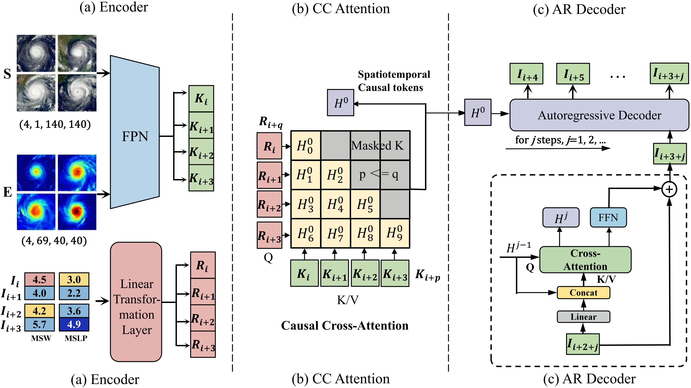

## [IEEE JSTARS 2026] MSCAR：基于多源数据学习时空依赖的热带气旋强度预报

[English](README.md) | [中文](README_zh.md)

> **作者：** Lei Liu, Hongwei Zhao, Xinyu Wang,  Kang Chen, Xiaoning Yu, Tao Han, Bin Li, Lei Bai.

> **论文：** https://ieeexplore.ieee.org/document/11519530.

## 1. 摘要

准确预测热带气旋（TC）强度对防灾减灾至关重要。现有方法主要依赖 ERA5 中有限的时空信息，忽略了历史强度序列与空间环境特征之间的时空依赖，难以充分刻画强度预报所需的时空规律。为此，我们提出多源多尺度约束自回归模型（MSCAR），首次将时空依赖建模与大规模多源数据结合，用于全球热带气旋强度的自回归预报。同时，为弥补缺少覆盖多种空间变量的综合数据集这一空白，我们构建了基于多源卫星与 ERA5 的热带气旋数据集（MSETCD），是目前时间跨度最长、最完整的全球热带气旋数据集。实验表明，MSCAR 优于现有方法，在全球和区域上的预报误差分别最多降低 9.52% 和 6.74%。数据集与源代码公开于 https://github.com/USTC-AI4EEE/MSCAR。

<p align="center">
  
</p>

**图 1.** MSCAR 整体架构：根据过去四个时刻预报未来 *j* 步热带气旋强度。(a) 编码器：异构空间数据经 FPN 处理融合生成空间 token，历史强度经线性层生成强度 token。(b) 约束交叉注意力（CC Attention）：在时间约束下，强度 token 作为 Query 关注作为 Key/Value 的空间 token，得到初始隐状态。(c) 自回归解码器：由该隐状态自回归预测未来强度。

## 2. 环境依赖

```bash
torch>=2.0.0
torchvision>=0.15.0
numpy>=1.21.0
pandas>=1.3.0
scipy>=1.8.0
einops>=0.6.0
pyyaml>=6.0
tensorboard>=2.10.0
```

## 3. 数据集

我们构建了基于多源卫星与 ERA5 的热带气旋数据集（MSETCD），这是一个面向强度预报研究的全球热带气旋数据集。

**下载：** [百度网盘](https://pan.baidu.com/s/1pORYl7Hm2LMeU4psytb30A?pwd=3in5)（提取码：3in5）

### 与现有数据集对比

|                         | **MSETCD**                      | Digital Typhoon       | HURSAT           | TCIR             |
| ----------------------- |:-------------------------------:|:---------------------:|:----------------:|:----------------:|
| 时间范围                | 1980–2022                       | 1978–2022             | 1978–2015        | 2003–2017        |
| 时间分辨率              | 3 小时                          | 1 小时                | 3 小时           | 3 小时           |
| 空间范围                | 全球                            | 西北太平洋            | 全球             | 全球             |
| 空间分辨率              | ~8 km（卫星）/ ~30 km（ERA5）   | ~5 km                 | ~8 km            | ~8 km            |
| 图像覆盖（像素）        | 572×572（卫星）/ 160×160（ERA5）| 512×512               | 301×301          | 201×201          |
| 变量                    | IR, WV, VIS, **ERA5（69 个变量）** | IR                 | IR, WV, VIS, NIR | IR, WV, VIS, PMW |
| 热带气旋数              | **4,668**                       | 1,099                 | 3,946            | 1,285            |
| 帧数                    | **282,505**                     | 189,364               | 237,516          | 70,501           |

### 其他数据来源

- **IBTrACS：** 国际气候管理最佳路径档案。[链接](https://www.ncei.noaa.gov/products/international-best-track-archive)
- **ERA5：** ECMWF 第五代再分析数据。[链接](https://www.ecmwf.int/en/forecasts/dataset/ecmwf-reanalysis-v5)
- **GridSat-B1：** NOAA 静止卫星数据。[链接](https://www.ncei.noaa.gov/products/gridded-geostationary-brightness-temperature)

## 4. 使用方法

数据打包：

```bash
python tools/prepare_data.py --data-dir /path/to/TC_datasets --ibtracs /path/to/ibtracs.ALL.list.v04r00.csv --begin-year 1980 --end-year 2017 --output data/train
python tools/prepare_data.py --data-dir /path/to/TC_datasets --ibtracs /path/to/ibtracs.ALL.list.v04r00.csv --begin-year 2018 --end-year 2020 --output data/evaluation
python tools/prepare_horizon.py --base-cache data/train --output data/train_120h --output-len 20
python tools/prepare_horizon.py --base-cache data/evaluation --output data/evaluation_120h --output-len 20
```

训练：

```bash
torchrun --nproc_per_node=8 train.py --config configs/mscar_24h.yaml
torchrun --nproc_per_node=8 train.py --config configs/mscar_120h.yaml
```

使用训练好的权重推理：

```bash
python test.py --config configs/mscar_24h.yaml --checkpoint checkpoints/mscar_24h.pth
python test.py --config configs/mscar_120h.yaml --checkpoint checkpoints/mscar_120h.pth
```

## 5. 实验结果

<p align="center">
  
</p>

**图 2.** 台风 LANE（SID: 2018226N11245）强度预报对比。"GT" 为真值，"6h PRE" 为 6 小时预报，"12~24h PRE" 为 12、18、24 小时预报。LANE 早期出现明显的快速增强（RI），随后强度复杂振荡，是检验模型鲁棒性的困难个例。

<p align="center">
  
</p>

**图 3.** 台风 HAISHEN（SID: 2020244N25146）强度预报对比。HAISHEN 生命史相对简单，MSCAR 对其强度峰值估计准确。

## 6. 致谢

感谢以下开源仓库提供的代码基础：

- MMSTN (2022): https://github.com/Zjut-MultimediaPlus/MMSTN
- MGTCF (2023): https://github.com/Zjut-MultimediaPlus/MGTCF

## 7. 引用

如果本工作对您的研究有帮助，请引用：

```bibtex
@ARTICLE{11519530,
  author={Liu, Lei and Zhao, Hongwei and Wang, Xinyu and Chen, Kang and Yu, Xiaoning and Han, Tao and Li, Bin and Bai, Lei},
  journal={IEEE Journal of Selected Topics in Applied Earth Observations and Remote Sensing}, 
  title={Learning Spatiotemporal Dependencies for Tropical Cyclone Intensity Forecasting with Multi-Source Data}, 
  year={2026},
  volume={},
  number={},
  pages={1-15},
  keywords={Modeling;Forecasting;Timing;Tropical cyclones;Satellites;Argon;Training;Long short term memory;Accuracy;Meteorology;Tropical cyclone intensity;multi-source;tropical cyclone dataset;deep learning;autoregressive forecasting},
  doi={10.1109/JSTARS.2026.3692673}}
```

如有问题，请联系 liulei13@ustc.edu.cn。
